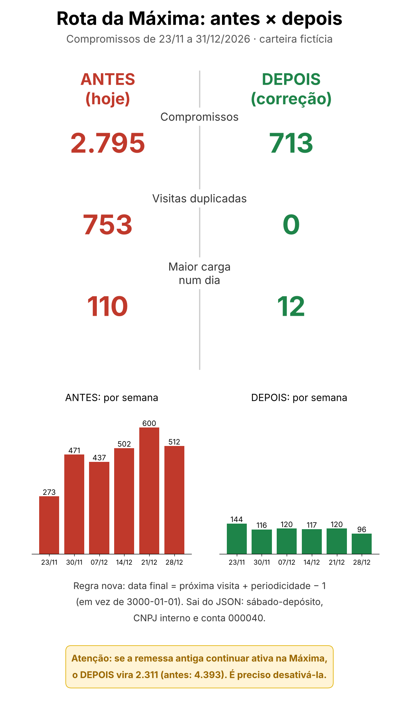

# T-0010: simulação da rota da Máxima, antes × depois

- O que muda: cada linha da rota passa a valer só até a véspera da próxima visita. Saem o sábado-depósito, o CNPJ interno e a conta 000040.
- Número principal (carteira fictícia, 23/11 a 31/12): de 2.795 para 713 compromissos, e as visitas duplicadas caem de 753 para 0.
- O que ele responde: aprova a regra para eu seguir com o código e os testes? Recomendação do gerente: sim. É a mesma regra proposta em 09/11, e nada vai ao PC sem o "instale". Efeito no prazo: o PR do código fica pronto cerca de 1 h depois do sim. Atenção: a remessa antiga precisa ser desativada na Máxima. Sem isso, fica em 2.311.
