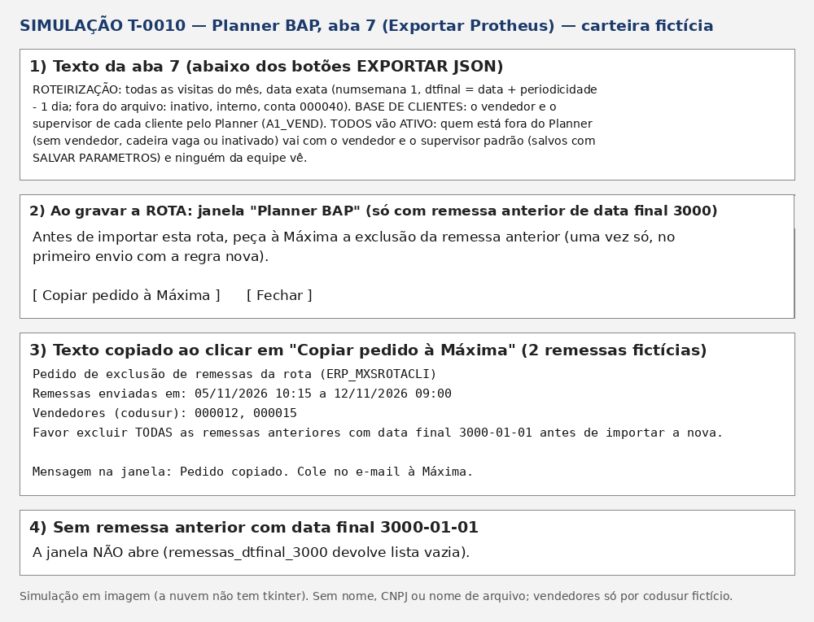

# T-0010: como fica o aviso na exportação da rota (imagem)

- O que muda: o aviso só abre quando ainda existe na Máxima uma remessa antiga com data final 3000-01-01. O botão copia um pedido pronto, sem nome, CNPJ ou nome de arquivo, que pede a exclusão de TODAS as remessas antigas.
- Número principal (carteira fictícia, com o sábado-depósito de volta): 297 dos 297 clientes ativos exportáveis têm compromisso na janela. Ficam fora só inativo (10), interno (3) e 000040 (12).
- O que ele responde: nada. É informativo, porque os textos já foram confirmados (R-20261120-104921-po).
