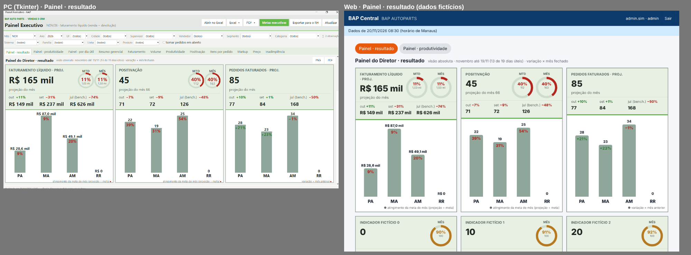

# T-0013: simulação da web, PC × web (Painel · resultado)

- O que muda: as abas "Painel · resultado" e "Painel · produtividade" no celular e no computador, atrás do login, com os mesmos cartões, anéis, comparações e barras por UF do PC.
- Número principal: os números do lado da web são fictícios, copiados do print para comparar o desenho. Na web de verdade, eles vêm do próprio PC, então saem iguais por construção.
- O que ele responde: aprova o visual para seguir ao deploy (que ainda pede a frase "aprovo deploy v0.1.0")? Recomendação do gerente: SIM. O visual segue o do PC, e nada vai ao ar sem a frase.
